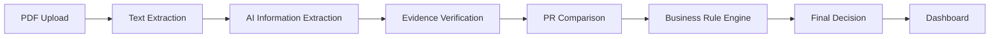

# SupplyGuard AI – Supplier Document Verification System

SupplyGuard AI is an automated compliance and verification tool designed for procurement and supply chain teams. It checks supplier quotation PDF documents against company purchase requests and internal purchasing policies.

By automatically checking unit prices, payment terms, delivery schedules, tax IDs, and contract clauses, SupplyGuard AI helps organizations prevent financial leakage, avoid non-compliant contracts, and speed up the vendor approval process.

---

## 1. Key Features

- **PDF Document Extraction:** Extracts clean text and metadata from supplier PDF files using PyMuPDF while preserving page numbers.
- **Gemini-Powered Information Extraction:** Uses Google Gemini 2.5 Flash to identify key commercial terms, line items, and contract clauses. Includes an offline fallback parser when no API key is set.
- **Purchase Request Comparison:** Matches quotations against internal purchase requests (`purchase-request.csv`) to compute price and quantity variances.
- **Automated Rule Validation:** Evaluates 12 deterministic purchasing rules covering price ceilings, advance payments, penalty clauses, and delivery timelines.
- **Evidence Verification:** Checks every AI-extracted quote directly against the source PDF text to prevent hallucinations and unverified claims.
- **Clear Decision Outcomes:** Classifies each supplier pack into `APPROVE`, `REJECT`, or `NEEDS A PERSON TO CHECK` using strict decision priority.
- **Batch Evaluation:** Compares all 10 sample supplier packs in a single summary table with detailed metrics.
- **Interactive Streamlit Dashboard:** User-friendly web interface featuring individual pack inspection, batch summaries, and custom PDF upload.
- **Dark Mode & Light Mode:** Toggle between Dark Navy and Clean Light themes with a single click.

---

## 2. Technology Stack

| Technology | Purpose |
| :--- | :--- |
| **Python 3.11+** | Core programming language |
| **Streamlit** | Web application framework for the dashboard |
| **Google GenAI SDK (`google-genai`)** | Interfaces with Gemini 2.5 Flash for structured data extraction |
| **LangGraph** | Orchestrates the 8-node step-by-step verification workflow |
| **Pydantic v2** | Data validation, schemas, and decimal precision handling |
| **PyMuPDF (`fitz`)** | Fast and accurate PDF text parsing |
| **Pandas** | Tabular data processing and batch comparison tables |
| **Pytest** | Automated unit and integration testing suite |

---

## 3. Project Architecture

SupplyGuard AI processes documents through a fixed, transparent 8-step pipeline:

1. **PDF Upload / Loading:** The supplier PDF is loaded and checked for readability.
2. **Text Extraction:** PyMuPDF extracts raw text page-by-page.
3. **AI Information Extraction:** Gemini 2.5 Flash (or the offline fallback parser) extracts structured quotation data into a typed schema.
4. **Evidence Verification:** Every extracted quote is checked as a verbatim substring in the original PDF text.
5. **Purchase Request Comparison:** The quoted price, quantity, and item details are compared against baseline purchase requests.
6. **Business Rule Engine:** 12 deterministic Python rules check legal, commercial, and arithmetic terms.
7. **Final Decision:** A decision resolver applies strict priority (`REJECT` > `NEEDS A PERSON TO CHECK` > `APPROVE`).
8. **Dashboard Display:** The findings, evidence citations, and decision reasons are presented in the Streamlit UI.



---

## 4. Project Structure

```
SupplyGuard-AI/
├── app.py                       # Application entry point
├── requirements.txt             # Project dependencies
├── pyproject.toml               # Pytest configuration
├── .env.example                 # Environment variables template
├── data/
│   └── sample/                  # Challenge dataset
│       ├── purchase-request.csv # Baseline purchase requisition (PR-2026-114)
│       ├── company-rules.md     # Official company purchasing rules
│       └── supplier-pack-01.pdf # 10 sample supplier quotation PDFs
│           ... to -10.pdf
├── src/
│   ├── config.py                # Configuration and environment management
│   ├── models/
│   │   ├── schemas.py           # Pydantic schemas (ExtractedQuotation, RuleFinding)
│   │   └── state.py             # LangGraph workflow state definition
│   ├── services/
│   │   ├── pdf_loader.py        # PDF text extraction with PyMuPDF
│   │   ├── gemini_extractor.py  # Gemini extraction & deterministic fallback parser
│   │   ├── evidence_verifier.py # Substring evidence verification service
│   │   ├── pr_repository.py     # Purchase request CSV loader and matcher
│   │   └── rule_engine.py       # Deterministic Python business rules engine
│   ├── ui/
│   │   ├── app.py               # Main Streamlit application and page routing
│   │   ├── components.py        # UI cards, tables, badges, and layout widgets
│   │   └── styles.py            # CSS styles for Dark and Light modes
│   └── workflow/
│       ├── graph.py             # LangGraph workflow definition
│       └── nodes.py             # Execution logic for each workflow node
└── tests/                       # Automated test suite (37 tests)
```

---

## 5. Installation & Setup

Follow these simple steps to set up and run SupplyGuard AI locally:

### Step 1: Clone the Repository
```bash
git clone https://github.com/your-username/SupplyGuard-AI.git
cd SupplyGuard-AI
```

### Step 2: Create a Virtual Environment
- **Windows:**
  ```powershell
  python -m venv .venv
  ```
- **macOS / Linux:**
  ```bash
  python3 -m venv .venv
  ```

### Step 3: Activate the Virtual Environment
- **Windows (PowerShell):**
  ```powershell
  .venv\Scripts\Activate.ps1
  ```
  *(If script execution is restricted, run: `Set-ExecutionPolicy -Scope Process -ExecutionPolicy Bypass`)*
- **Windows (Command Prompt):**
  ```cmd
  .venv\Scripts\activate.bat
  ```
- **macOS / Linux:**
  ```bash
  source .venv/bin/activate
  ```

### Step 4: Install Dependencies
```bash
pip install -r requirements.txt
```

### Step 5: Configure the Gemini API Key (Optional)
To use live Gemini 2.5 Flash extraction:
1. Copy `.env.example` to create a `.env` file:
   - **Windows:** `copy .env.example .env`
   - **macOS / Linux:** `cp .env.example .env`
2. Open `.env` and add your Google Gemini API key:
   ```env
   GEMINI_API_KEY=your_actual_api_key_here
   GEMINI_MODEL=gemini-2.5-flash
   ```
3. You can get a free API key from [Google AI Studio](https://aistudio.google.com/).

> **Note:** Never commit your `.env` file or API key to Git. The `.gitignore` file already excludes `.env`. If you do not have an API key, the system runs automatically using its built-in offline fallback parser without errors.

---

## 6. Run the Application

Start the Streamlit dashboard using:

```bash
streamlit run app.py
```

Or through the virtual environment directly:
```bash
.venv\Scripts\streamlit run app.py
```

Once running, open your browser and navigate to:
```
http://localhost:8501
```

---

## 7. Business Decision Rules

SupplyGuard AI evaluates quotations against 12 company purchasing rules. Decisions follow a strict priority order:

$$\textbf{REJECT} \succ \textbf{NEEDS A PERSON TO CHECK} \succ \textbf{APPROVE}$$

### Rejection Conditions (Automatic Rejection)
A quotation is automatically rejected if any of the following are true:
1. **Price Too High (`R1`):** Quoted unit price exceeds the purchase request maximum by more than 3%.
2. **Excessive Advance Payment (`R2`):** Supplier demands more than 20% advance payment.
3. **Missing or Low Penalty Clause (`R3`):** The contract omits a late-delivery penalty clause or sets a rate below 0.5% per week.
4. **Missing Tax Registration (`R4`):** Supplier fails to provide both a valid TIN and BIN.
5. **Delivery Too Late (`R5`):** Promised delivery schedule is more than 45 days after the Purchase Order.

### Human Review Conditions (Flagged for Review)
If there are no rejections, a quotation is flagged for human check if any of the following apply:
1. **Marginal Price Excess (`H1`):** Quoted price exceeds maximum by 0% to 3%.
2. **Quantity Variance (`H2`):** Quoted quantity differs from the requested quantity by more than 5%.
3. **Payment Window Mismatch (`H3`):** Payment terms fall outside the standard 30 to 60 days after delivery window or are ambiguous.
4. **Moderate Delivery Delay (`H4`):** Promised delivery is between 31 and 45 days.
5. **VAT Not Separated (`H5`):** VAT is not itemized as a separate 15% line item (e.g. "VAT included").
6. **Arithmetic Discrepancy (`H6`):** Numbers do not add up correctly (line item, subtotal, VAT, or grand total).
7. **Short Validity (`H7`):** Quotation validity period is less than 30 days.
8. **Unverified Evidence (`H0`):** An extracted citation cannot be verified in the source PDF text.

---

## 8. Testing

The project includes an automated test suite using `pytest`.

### Run the Tests
```bash
pytest -v
```

### Verified Test Results
All **37 tests pass** in approximately 9 seconds:

```
============================= test session starts =============================
platform win32 -- Python 3.11.9, pytest-9.2.0, pluggy-1.7.0
rootdir: E:\SupplyGuard-AI
collected 37 items

tests/test_e2e_golden_packs.py::test_golden_pack_evaluation (10 tests)  PASSED
tests/test_evidence_verifier.py (2 tests)                              PASSED
tests/test_gemini_integration.py (3 tests)                             PASSED
tests/test_pdf_loader.py (10 tests)                                    PASSED
tests/test_rule_engine.py (12 tests)                                   PASSED

============================= 37 passed in 9.07s ==============================
```

- **End-to-End Pack Tests (10):** Verifies that all 10 sample packs match expected ground-truth decisions (100% accuracy).
- **Rule Engine Boundary Tests (12):** Validates mathematical edge cases (e.g., exactly +3.0% vs +3.01% price, 20.0% vs 20.1% advance payment).
- **Evidence Verification Tests (2):** Tests substring citation matching, multiline normalization, and hallucination detection.
- **Gemini Integration Tests (3):** Validates Pydantic schema parsing, error recovery, and the offline fallback parser.
- **PDF Loader Tests (10):** Confirms that PyMuPDF successfully extracts text from each sample PDF file.

---

## 9. Sample Data

The `data/sample/` directory contains files provided for testing and evaluation:

- **`supplier-pack-01.pdf` to `supplier-pack-10.pdf`:** Ten sample supplier quotation documents covering realistic procurement scenarios:
  - **Packs 01 & 02:** Fully compliant quotations (`APPROVE`).
  - **Packs 04, 07 & 09:** Minor variances such as marginal price excess, quantity differences, and calculation errors (`NEEDS A PERSON TO CHECK`).
  - **Packs 03, 05, 06, 08 & 10:** Critical violations including excessive price, 40% advance payment, missing penalty clause, missing TIN/BIN, and 60-day delivery (`REJECT`).
- **`purchase-request.csv`:** Baseline requisition `PR-2026-114` containing item codes, descriptions, requested quantities, and maximum allowable unit prices for Items A through E.
- **`company-rules.md`:** The official company procurement policy defining all 12 commercial, legal, and operational compliance rules.

---

## 10. Important Note

SupplyGuard AI is an **automated decision-support tool** designed to assist procurement professionals by rapidly identifying policy violations, contractual risks, and arithmetic discrepancies.

**It does not replace human oversight.** Final procurement decisions, supplier negotiations, and purchase order commitments should always be confirmed by authorized procurement personnel.
